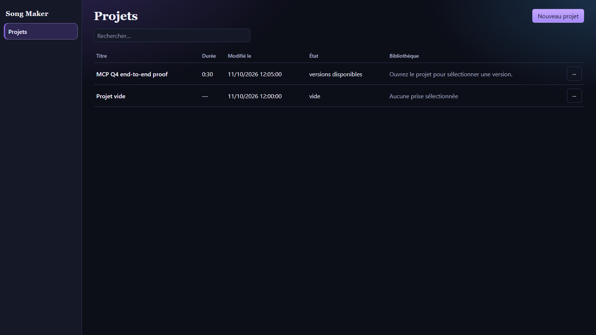
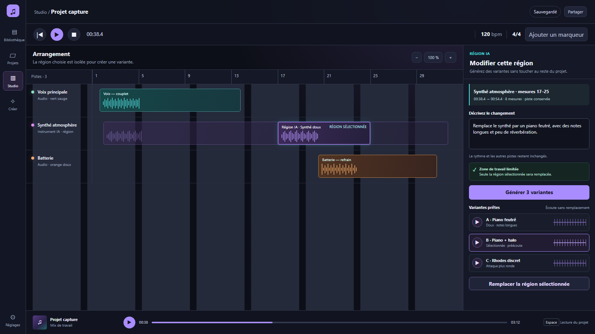
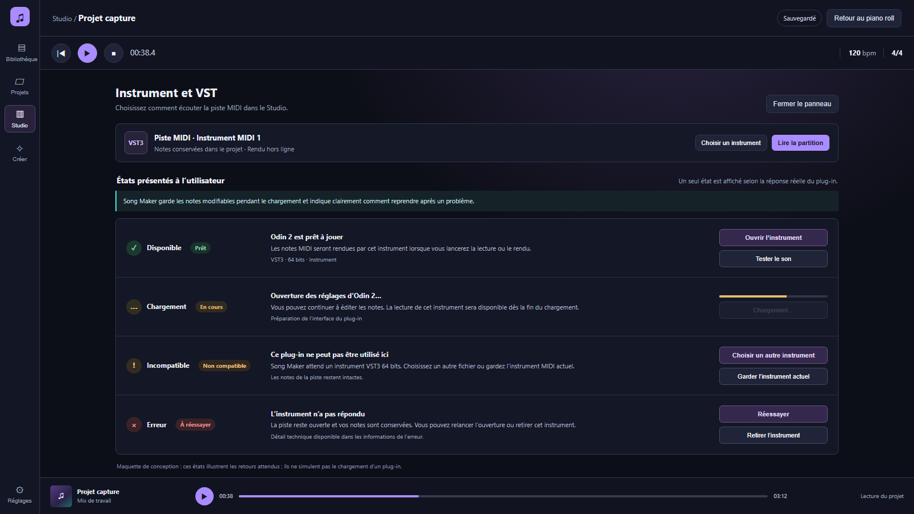

# Revue visuelle #420 — compléments

Ces écrans complètent la revue des vues **Bibliothèque**, **Studio**, **Créer**, **MIDI** et **Export**. Ils reprennent la palette et la navigation déjà validées : fond indigo sombre, action violette, région sélectionnée en cyan et commandes resserrées autour de la timeline.

La vue **Projets** est une capture du composant React de prévisualisation, avec un projet contenant une prise MCP et un projet vide. Elle montre l’état de la liste ; ce n’est pas une capture de l’installeur Windows.

La vue **Édition IA** est une proposition statique de parcours : une région et ses bornes sont visibles dans la timeline, le texte ne cible que cette région, les variantes s’écoutent avant remplacement et le panneau rappelle que les autres pistes restent intactes.

La vue **États VST** met côte à côte les retours « prêt », « chargement », « non compatible » et « erreur ». Elle illustre le contenu attendu pour chaque état ; aucun plug-in n’est lancé et aucune génération IA n’est exécutée par ces maquettes.

## Captures

### Projets

### Édition ciblée d’une région IA

### États de l’instrument VST

